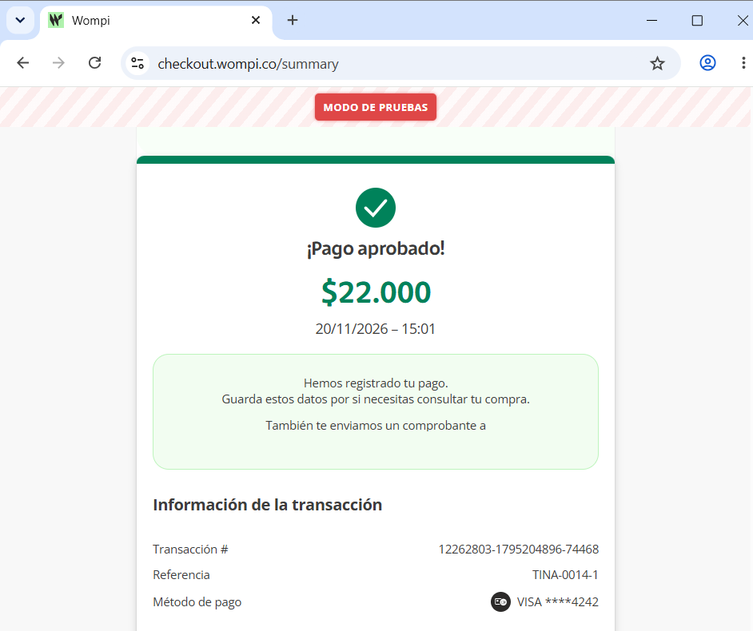

# Tina — tienda en línea hecha con Flutter

Tienda en línea de Tina ("Tan latinas como tú"), hecha con Flutter y conectada
a **Supabase**. Los datos siguen el modelo entidad-relación del proyecto
(categorías, productos, variantes con stock, clientes, pedidos, pagos,
comprobantes, envíos, historial).

## Qué es real y qué sigue simulado

| | Estado |
|---|---|
| Catálogo (categorías, productos, variantes con stock, promociones) | **Real**: se lee de Supabase y la administradora lo edita desde el panel |
| Fotos de artículos y del sitio | **Reales**: las sube la administradora desde el panel y las ve todo el mundo |
| Cuentas e ingreso (clientas y administradora) | **Reales**: Supabase Auth, un solo ingreso para todas |
| Pedidos (crear, ver, cambiar estado), stock, descuentos y envío | **Reales**: los crea y calcula Supabase |
| Contraentrega en Cali | **Real**: pedido pendiente que se coordina por WhatsApp |
| Pago en línea con Wompi | **En modo de pruebas, de punta a punta**: la tienda crea el pedido, lleva a la página de pago de Wompi, el pago de prueba se aprueba, Wompi avisa a la tienda y el pedido pasa solo a "Pagado" con su comprobante (ver [la sección de pasarela de pago](#pasarela-de-pago-modo-de-pruebas)). Falta pasar a producción |

Sin conexión, o en las pruebas, la app usa **datos de ejemplo** coherentes con
el modelo.

## Cómo ejecutarlo

Desde la carpeta del proyecto (la que tiene `pubspec.yaml`):

```bash
flutter pub get
flutter run -d chrome
```

- **Chrome:** es el destino que funciona. Como app de Windows hace falta Visual
  Studio, que no es necesario para esto.
- **Windows:** activa el *Modo de desarrollador* (`Win + R` →
  `ms-settings:developers`); Flutter lo necesita para los paquetes con plugins.
- **Internet:** la fuente (Bricolage Grotesque e Instrument Serif) se descarga
  de Google Fonts, y el catálogo y las fotos vienen de Supabase.
- En Chrome, abre la ventana a un ancho de 900 px o más para ver el diseño de PC.

Las pruebas y el análisis:

```bash
flutter analyze
flutter test
```

## Conexión con Supabase

Los scripts de la base de datos están en [`supabase/`](supabase/LEEME.md): el
esquema, las reglas de seguridad, las carpetas de fotos, los datos iniciales y
la cuenta de administradora. Hay que ejecutarlos una vez, en orden, en el
*SQL Editor* de tu proyecto.

La URL del proyecto y la llave pública están en `lib/config/supabase_config.dart`.
Esa llave está hecha para ir dentro de la app: **lo que protege los datos son las
reglas de seguridad de la base de datos**, no esconderla. La llave `service_role`
o `secret` nunca debe estar en el repositorio.

## Pasarela de pago: modo de pruebas

La integración con la pasarela de pago **Wompi** está en **modo de pruebas**
(*sandbox*): no se mueve dinero real y se paga con tarjetas de prueba. La
captura es de un pago de prueba aprobado en la página de Wompi, con su letrero
"Modo de pruebas":



Qué está probado y qué falta:

- **Funciona:** la tienda crea el pedido, genera el enlace de pago con la firma de
  integridad y lleva a la clienta a la página de Wompi, donde el pago de prueba
  (tarjeta `4242 4242 4242 4242`) se aprueba. Wompi avisa a la tienda con un
  aviso firmado, la tienda comprueba la firma y el monto, y el pedido pasa a
  "Pagado" con su comprobante. Al volver, la clienta ve "Pedido confirmado".
- **Un detalle de los secretos:** en Wompi los secretos aparecen ocultos con
  asteriscos; hay que presionar "Mostrar" antes de copiarlos, o se guardan los
  asteriscos y la firma falla. `supabase/pruebas/probar_aviso_wompi.ps1` comprueba
  que el secreto de eventos guardado en Supabase sea el correcto.
- **Para producción:** cambiar las llaves y los secretos de pruebas por los de
  producción y poner la dirección real de la tienda.

Los pasos para activarlo están en [`supabase/LEEME.md`](supabase/LEEME.md).

## Ingreso único y panel de la vendedora

Hay **un solo ingreso** (Cuenta → Iniciar sesión) para clientas y administradora:

- Quien es **administradora** (está en la tabla `usuario` con ese rol) va directo
  al **panel de la vendedora**. En su cuenta también ve el botón "Ir al panel".
- Las **clientas** van a la tienda. No ven ningún acceso al panel.
- Las clientas se registran desde el mismo formulario. Si Supabase tiene activada
  la confirmación de correo, la app avisa que hay que confirmarlo.

El panel tiene seis secciones:

1. **Pedidos:** filtra por estado y cámbialos; cada cambio queda en el historial.
   Al abrir un pedido ves el **contacto de la clienta** (nombre, teléfono y
   correo, que se pueden seleccionar y copiar), el envío, el pago y el historial.
2. **Datos cliente:** los números de los pedidos para tomar decisiones: estado
   actual de los pedidos, balance general de las ventas (total vendido, ya
   cobrado, por cobrar, cancelado), descuentos dados, compra promedio, producto
   más vendido, producto más recomprado, colores más vendidos, tiempo de
   recompra, ciudades con mayor recompra y cómo pagan. No cuenta los pedidos
   cancelados; una recompra es un pedido de una clienta que ya tenía otro antes.
3. **Productos e inventario:** lista todos los productos con su stock total y el
   de **cada color** (avisa cuando queda poco o está agotado) y permite
   mostrarlos u ocultarlos con un interruptor. Desde aquí se **crea un producto
   nuevo** o se edita uno: nombre, descripción, técnica, precio, categoría, sus
   colores con su propio stock, y sus **fotos**. Lo mínimo para crear un
   producto es nombre, precio, un color con su stock y la foto de portada.
   Cada color tiene su lugar para subir fotos: cuando la clienta elige ese color
   en la tienda ve esas fotos, y si el color no tiene, ve la portada. Las fotos
   se suben al guardar. Un producto no se borra, se oculta; una fila que ya
   tiene pedidos tampoco se borra, se deja con stock 0.
4. **Colecciones:** crea colecciones (grupos de productos con nombre, subtítulo y
   foto), edítalas, muéstralas u ocúltalas y bórralas. A cada producto se le
   asigna su colección en el editor de productos.
5. **Fotos de artículos:** elige un artículo; sube, ordena, haz principal o borra
   sus fotos generales (la portada). La primera es la que se ve en la tienda.
6. **Fotos del sitio:** cambia o quita la foto de cada lugar de la página. Por
   ahora solo la **portada del inicio** se muestra en la tienda; el logo, el
   banner de mayoreo y el fondo ya se pueden preparar, pero todavía no se ven.

Solo la administradora puede cambiar productos, stock y fotos: las reglas de
seguridad de Supabase rechazan cualquier cambio sin su sesión, aunque se llame
directo a la base de datos.

## La tienda

El diseño toma la estructura de una tienda de accesorios bien organizada, pero
con la identidad de Tina (su naranja, sus manchas, sus estrellas y su grano):

- **Portada:** franja de promoción, cabecera, portada de marca con "Comprar
  ahora", cinta de confianza, categorías en círculos con foto, una sección de
  productos por categoría, mosaico de categorías, colecciones, banner "Arma tu
  collar", beneficios, garantías y pie de página.
- **Catálogo:** filtros por disponibilidad, color (con cantidad) y precio, y
  orden por precio o nombre.
- **Producto:** fotos por color, miniaturas, migas de pan y pestañas de
  descripción, envíos y cuidados.
- **Buscador:** por nombre, categoría, color, colección y descripción.
- **Charm Bar:** la clienta arma su collar en cuatro pasos (color, cuántos
  charms, si van fijos o removibles, y cuáles). El collar y cada charm van al
  carrito como productos normales y descuentan su propio stock. El collar base
  es un producto de la categoría "Charm Bar" (cada color y modo es una
  variante) y los charms son productos de la categoría "Charms"; ambos se
  crean y se activan desde el panel.
- **Suscripción:** en el pie de página la clienta deja su correo; la lista queda
  en la tabla `suscripcion` de Supabase, que solo ve la administradora.

El número de WhatsApp y las redes de la tienda están en
`lib/config/tienda_config.dart`: lo que quede vacío no se muestra.

## Diseño para PC y para celular

La app se adapta al ancho de la ventana (`lib/utils/adaptable.dart`):

- **900 px o más (PC):** barra superior con los enlaces (Inicio, Categorías,
  Carrito, Cuenta), grilla de 4 columnas, y dos columnas en el detalle del
  producto, el carrito y el checkout. La acción principal queda fija abajo a la
  derecha.
- **Menos de 900 px (celular):** barra superior simple y navegación inferior,
  grilla de 2 columnas y una sola columna.

`TinaScaffold` elige el marco según el ancho, así que las Pages son las mismas
en los dos diseños.

## Animaciones y efectos

- **Intro animada** (`TinaIntro`): al iniciar sesión o registrarte, la portada
  abre con las letras de "Tina" escribiéndose una por una con un lápiz que las
  traza y se desvanece, la estrella de la ı con un rebote y el eslogan. Sale
  suavemente, se puede saltar con un clic y solo aparece una vez por inicio de
  sesión (si entras desde el checkout, aparece al llegar a la portada).
- **Efectos al pasar el mouse** (solo en PC, `TinaHover`): los botones y las
  tarjetas suben un poco con transición suave de color; el borde de los campos
  cambia de color; las filas del resumen se resaltan; las pastillas, etiquetas y
  muestras de color crecen y giran apenas; los enlaces cambian de color y la
  flecha de "volver" se mueve; "Quitar" se oscurece. Ningún efecto usa sombras.

## Recorrido de prueba

1. **Portada** → elige una categoría o abre un producto.
2. **Detalle** → elige color, talla y cantidad (el límite es el stock) y agrega al carrito.
3. **Carrito** → cambia la cantidad, quita una línea y mira los descuentos
   (20% en la primera compra con cuenta, 30% con 14 o más unidades).
4. **Checkout** → compra como invitada o con cuenta. Para tener cuenta, crea una
   desde Cuenta → Regístrate.
5. **Confirmación** → número de pedido, comprobante y estado. El stock baja.
6. **Cuenta** (barra inferior) → pedidos de la clienta y cierre de sesión.
7. **Panel de vendedora** (entra con la cuenta de administradora) → pedidos,
   productos e inventario, y fotos.
8. **Link Del Video**
https://youtu.be/eZb26JoHPJ4

## Cómo está organizado el código

```
lib/
  config/        Datos de conexión con Supabase (URL y llave pública)
  models/        Una clase por tabla del modelo entidad-relación
  data/          Catálogo, sesión y fotos (Supabase) y datos de ejemplo
  logic/         Reglas sin pantalla: descuentos, primera compra, validaciones
  theme/         Colores y tipografía de Tina
  components/    Widgets reutilizables de la galería de diseño (uno por archivo)
  pages/         Pages: muestran datos y reportan con callbacks; no guardan estado
  screens/       tina_screen.dart: la Screen anfitriona
supabase/        Scripts SQL de la base de datos y guía para ejecutarlos
test/            Pruebas de datos, lógica, componentes, ingreso, panel y recorrido
```

### Estado y comunicación

- **El estado vive en la Screen anfitriona** (`TinaScreen`): catálogo con stock,
  fotos, carrito, pedidos, sesión, selección del detalle y formularios.
- **Las Pages** reciben datos y callbacks. Ninguna guarda datos de la app por su
  cuenta. Los componentes tampoco: los selectores y campos reciben el valor y
  avisan cada cambio.
- **Supabase detrás de interfaces:** la Screen no habla con Supabase
  directamente; usa `CatalogoRepositorio`, `SesionRepositorio` y
  `AdministradoraRepositorio`. Así las pruebas corren sin red, con versiones de
  mentira.
- **Navegación:** `TinaScreen` mantiene una pila de rutas (`Ruta`) y la entrega
  a un `Navigator` con páginas. El botón "atrás" del sistema retrocede por esa
  pila. La barra inferior (Inicio, Categorías, Carrito, Cuenta) cambia de sección.

## Reglas de la compra

- **Envío:** $5.000 fijos para todo el país; la vendedora asume el resto. Se
  suma al total: `total = subtotal − descuento + envío`. El valor está en la
  tabla `ajuste_tienda` de Supabase (`costo_envio`).
- **Descuentos:** 20% en la primera compra con cuenta y 30% con 14 o más
  unidades. No se acumulan: si aplican los dos, se toma el mayor.
- **Contraentrega:** solo si el envío es a **Cali, Valle del Cauca**. La clienta
  marca contraentrega y la vendedora la contacta por WhatsApp para coordinar. El
  pago es **por transferencia** (el domiciliario entrega, pero no recibe dinero)
  y **no se cobra envío**. El pedido queda pendiente; cuando llega la
  transferencia, la administradora lo pasa a "Pagado" desde el panel y se crea el
  comprobante.
- **Stock:** se descuenta al crear el pedido. Si el pedido se cancela, el stock
  vuelve. Los precios, descuentos y el stock los calcula la base de datos al
  crear el pedido, no el navegador.

## Pendientes

- **Pago en línea con Wompi:** funciona de punta a punta en modo de pruebas.
  Falta pasar a las llaves de producción y a la dirección real de la tienda (ver
  [`supabase/LEEME.md`](supabase/LEEME.md)).
- **Pedidos sin pagar:** si una clienta no termina de pagar en Wompi, el pedido
  queda pendiente con el stock apartado hasta que la vendedora lo cancele desde
  el panel. Falta que se venzan solos.
- **Apple Pay:** necesita una pasarela distinta de Wompi (se está evaluando
  Kushki, que lo tiene en beta para Colombia, solo con Visa y Mastercard).
- **Aviso de pedidos nuevos:** el código está listo y probado (por correo con
  Resend y/o por WhatsApp con CallMeBot), pero hay que activarlo en Supabase:
  script 9, los secretos del canal que uses y la función `avisar-pedido` (ver
  [`supabase/LEEME.md`](supabase/LEEME.md)).
- **Guía del pedido** para imprimir o descargar desde el panel.
- **Categorías nuevas:** las de Charm Bar y Charms vienen en el script 10; otras
  categorías todavía no se pueden crear desde el panel.
- **Fotos por poner:** el Charm Bar necesita las fotos del collar y de cada
  charm, y los lugares "Banner Charm Bar" y "Foto del Charm Bar" en Fotos del
  sitio; las colecciones, su foto.
- **Reseñas y prueba social:** falta tener reseñas reales para mostrarlas.
- **Publicación:** la app todavía no está publicada en internet.
- **Diseño:** pendiente darle un aspecto más artesanal, hecho a mano, con las
  fotos reales de las piezas.
